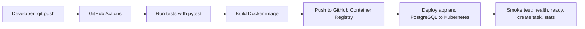
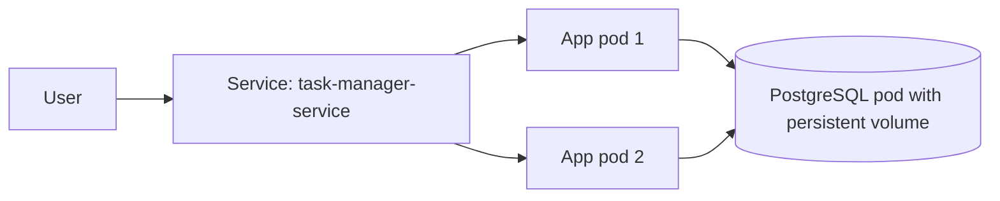

# Task Manager: Automated CI/CD with Docker, GitHub Actions and Kubernetes


A Flask task manager (priorities, categories, due dates, search, filters, statistics and dark mode) used to demonstrate a complete CI/CD pipeline. Every `git push` is tested, containerized, published to a registry and deployed to Kubernetes together with a PostgreSQL database.

## Architecture





## Tech stack

| Tool | Purpose |
|---|---|
| Python / Flask / SQLAlchemy | The web app, REST API and database access |
| PostgreSQL | Persistent shared storage (SQLite is used for local runs and tests) |
| pytest | Automated tests |
| Docker | Packages the app into an image |
| GitHub Actions | CI/CD automation |
| GitHub Container Registry | Stores the published images |
| Kubernetes | Runs the app (2 replicas) and the database (StatefulSet) |

## Pipeline stages

1. **test:** installs dependencies and runs pytest against an in-memory database. If a test fails, the pipeline stops.
2. **build-and-push:** builds the Docker image, tags it with the commit SHA and `latest`, and pushes it to `ghcr.io`.
3. **deploy-test:** creates a temporary Kubernetes cluster (kind), generates a random database password Secret, deploys PostgreSQL and the app, waits for the rollouts and smoke tests the running stack (`/health`, `/ready`, creating a task, reading statistics).

## Project structure

```
.
├── app.py                    # Flask application and API
├── templates/index.html      # Web interface (light and dark mode)
├── test_app.py               # Automated tests
├── Dockerfile                # Image build instructions
├── requirements.txt          # Runtime dependencies
├── requirements-dev.txt      # Test dependencies
├── k8s/
│   ├── deployment.yaml       # App: 2 replicas, probes, resource limits
│   ├── service.yaml          # LoadBalancer Service for the app
│   └── postgres.yaml         # PostgreSQL StatefulSet, volume claim and Service
└── .github/workflows/ci.yml  # The pipeline
```

## Run it locally with Docker

```bash
docker build -t task-manager:local .
docker run --rm -p 5000:5000 task-manager:local
```

Open http://localhost:5000 (uses SQLite inside the container, so data is lost when it stops).

## Run it on Kubernetes

Requires a cluster (for example Docker Desktop with Kubernetes enabled). The database password is stored in a Kubernetes Secret and is never committed to Git.

```bash
kubectl create secret generic postgres-secret --from-literal=password=<choose-a-password>
kubectl apply -f k8s/
kubectl get pods
```

Open http://localhost:8080

## Kubernetes features demonstrated

- **Load balancing:** the Service spreads requests across 2 app pods.
- **Self-healing:** a deleted pod is recreated automatically.
- **Rolling updates:** new versions replace old pods with zero downtime.
- **Rollback:** `kubectl rollout undo deployment/task-manager`
- **Health probes:** liveness uses `/health` (process alive), readiness uses `/ready` (database reachable).
- **Persistent storage:** PostgreSQL runs as a StatefulSet with a PersistentVolumeClaim, so data survives pod restarts.
- **Secrets:** the