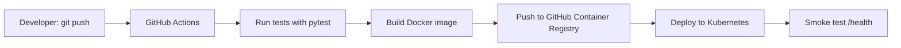

# Task Manager: Automated CI/CD with Docker, GitHub Actions and Kubernetes


A small Flask to-do app used to demonstrate a complete CI/CD pipeline: every `git push` is tested, containerized, published to a registry and deployed to Kubernetes automatically.

## Architecture



## Tech stack

| Tool | Purpose |
|---|---|
| Python / Flask | The web app and REST API |
| pytest | Automated tests |
| Docker | Packages the app into an image |
| GitHub Actions | CI/CD automation |
| GitHub Container Registry | Stores the published images |
| Kubernetes | Runs the app (2 replicas, health checks, rolling updates) |

## Pipeline stages

1. **test**: installs dependencies and runs pytest. If a test fails, the pipeline stops.
2. **build-and-push**: builds the Docker image, tags it with the commit SHA and `latest`, and pushes it to `ghcr.io`.
3. **deploy-test**: creates a temporary Kubernetes cluster (kind), deploys the manifests with the new image, waits for the rollout and smoke tests `/health`.

## Project structure

```
.
├── app.py                    # Flask application
├── test_app.py               # Automated tests
├── Dockerfile                # Image build instructions
├── requirements.txt          # Runtime dependencies
├── requirements-dev.txt      # Test dependencies
├── k8s/
│   ├── deployment.yaml       # 2 replicas, probes, resource limits
│   └── service.yaml          # LoadBalancer Service
└── .github/workflows/ci.yml  # The pipeline
```

## Run it locally with Docker

```bash
docker build -t task-manager:local .
docker run -d -p 5000:5000 --name task-app task-manager:local
```

Open http://localhost:5000

## Run it on Kubernetes

Requires a cluster (for example Docker Desktop with Kubernetes enabled).

```bash
kubectl apply -f k8s/
kubectl get pods
```

Open http://localhost:8080

## Kubernetes features demonstrated

- **Load balancing:** the Service spreads requests across 2 pods.
- **Self-healing:** a deleted pod is recreated automatically.
- **Rolling updates:** new versions replace old pods with zero downtime.
- **Rollback:** `kubectl rollout undo deployment/task-manager`
- **Health probes:** readiness and liveness checks on `/health`.

## Known limitations and future improvements

- Tasks are stored in memory, so each pod has its own list and data is lost on restart. A production version would use a shared database such as PostgreSQL.
- CD deploys to a temporary cluster. A production setup would deploy to a managed cluster (EKS, GKE or AKS).
- Flask's development server is used. Production would use Gunicorn behind an ingress.
- Possible additions: image vulnerability scanning, Helm charts, monitoring with Prometheus and Grafana.